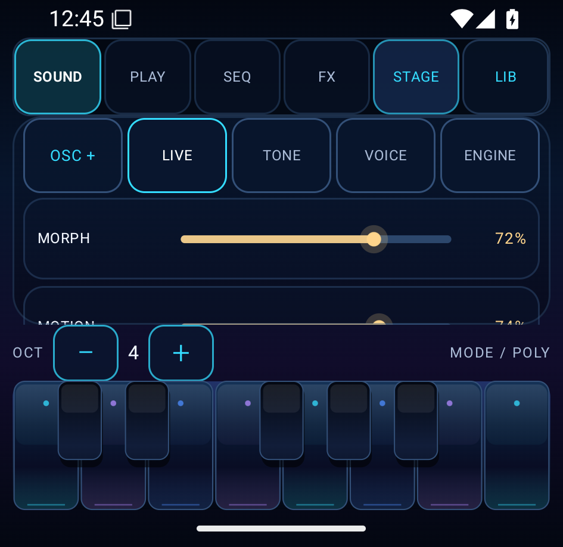
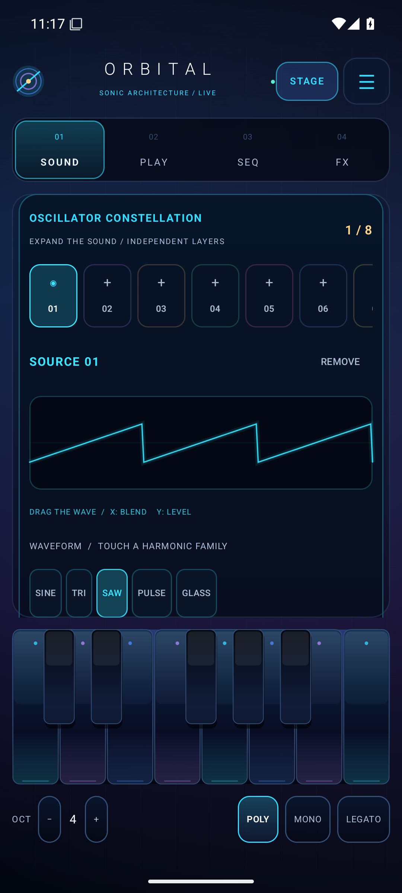
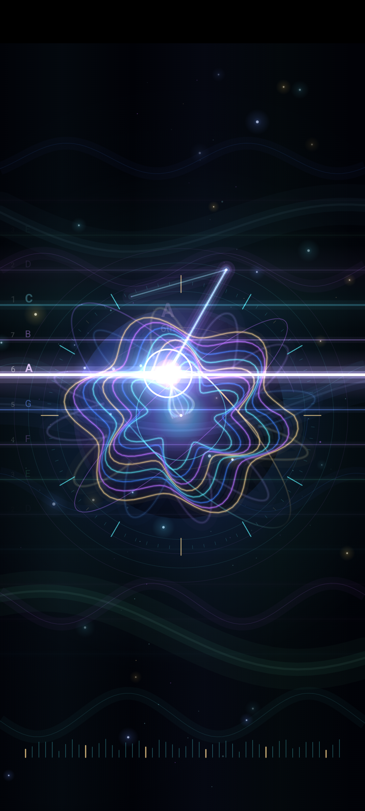
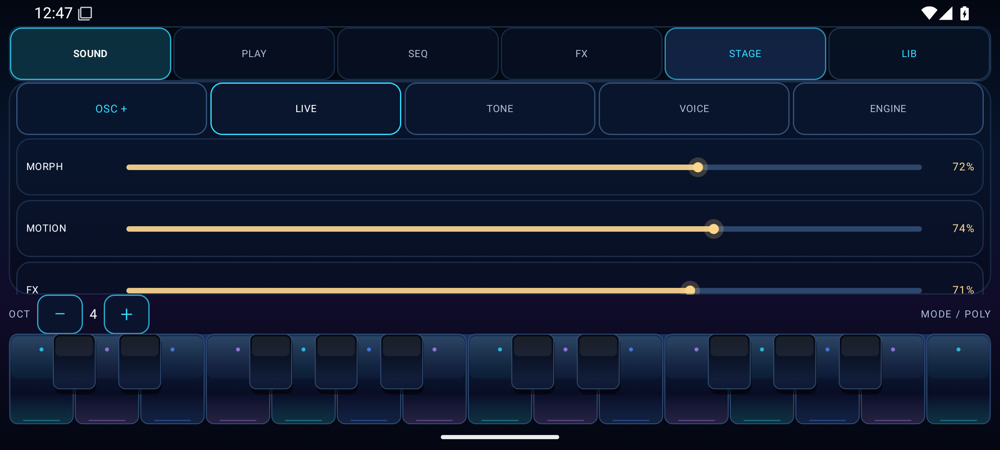

# ORBITAL — Android multi-engine synthesizer

> **Status · 3 November 2026:** developer alpha with working synthesis, touch performance and Android MIDI code; **not a finished commercial instrument or Play Store release**. The real running-app screenshots below are separate from the generated concept artwork.
>
> **Verified source:** [`0494c2d`](https://github.com/boop-bip80/Android-synth/commit/0494c2dcb39cad0feecd5808e26471c55f967564) · [API 35 GitHub Actions run #41677043446](https://github.com/boop-bip80/Android-synth/actions/runs/41677043446) — **all nine required jobs passed** (host, seven emulator lanes, and two-shard test-method union). The screenshot-only follow-up is [`53f3cb4`](https://github.com/boop-bip80/Android-synth/commit/53f3cb45ae41b5dc8b1c1c3f61d4099a8a602dcb). Later application-code changes must pass again before inheriting this result.

ORBITAL is a native Kotlin/Jetpack Compose instrument for Android 8.0+ (API 26+), designed around expressive touch interaction and a layered, polyphonic DSP engine.

## Real Android screenshots — captured from the running APK

These five PNGs are committed, permanent **Android 15 / API 35 x86_64 emulator framebuffers**, not generated renders, Figma mockups, or photographs of physical hardware. Their dimensions, hashes, source run and capture methods are documented in [screenshot provenance](docs/screenshots/PROVENANCE.md).

| Playing / editing | Performance / small screen |
| --- | --- |
|  |  |
| **Normal portrait** | **360 × 350dp compact SOUND** |
|  |  |
| **OSC1 workbench** | **FOCUS during a real held-note gesture** |



*Wide landscape. These frames prove the app rendered in those states during the successful test run. They do not prove real-phone frame rate, audio latency, thermals or pixel-level fidelity to the concept.*

## Install the tested Android APK

- **Tested debug build:** [download `orbital-debug-apk` ZIP from successful main run #41677043446](https://github.com/boop-bip80/Android-synth/actions/runs/41677043446/artifacts/13251586570). The ZIP contains the Android debug-signed APK built from [`0494c2d`](https://github.com/boop-bip80/Android-synth/commit/0494c2dcb39cad0feecd5808e26471c55f967564). GitHub Actions artifact retention is **14 days** (this artifact expires **17 November 2026**).
- **Permanent release:** [check GitHub Releases](https://github.com/boop-bip80/Android-synth/releases). A permanently downloadable, independently verified release APK has **not yet been published**; do not mistake the expiring CI artifact for a final release.
- Requires Android 8.0+; installing a debug APK may require enabling sideloading. This is not a Play-signed production build.

To see the latest verified build rather than this dated snapshot, use [successful `main` workflow runs](https://github.com/boop-bip80/Android-synth/actions/workflows/android.yml?query=branch%3Amain+is%3Asuccess) and check the exact commit SHA and job conclusions before downloading.

## What is implemented

| Area | Current implementation | Boundaries |
| --- | --- | --- |
| Synthesis | **Five selectable engines**; up to **16 voices**, eight editable oscillator layers, wavetable morphing/unison and analog-inspired/digital synthesis | A model-inspired design, **not calibrated 1:1 hardware emulation**; full-capacity device CPU headroom unknown |
| Modulation | Eight programmable LFOs, up to 64 routes, ADSR, performance morph/X/Y, pitch, filter and pan destinations | Finite capacities; not an unlimited modular graph |
| Effects | Six ordered stereo FX slots; saturation, tremolo, chorus, delay, stereo FDN reverb, phaser and bitcrusher; wet/bypass and parameter controls | Quality and long-session performance need listening/hardware evaluation |
| Touch | SOUND, PLAY, SEQ, FX and library controls; chromatic multitouch keyboard; on-screen oscillator and modulation editors; keyboardless **FOCUS** black canvas with live audio-reactive visuals | Screen-pressure behavior depends on device input; not a force sensor guarantee |
| Musical tools | Source-aware arpeggiator, 1–64-step sequencer, scales, swing, patterns, touch and Android MIDI input | Physical MIDI keyboards, timing under load and per-note MPE are not fully qualified |
| Presets / storage | 25 factory sound patches, 12 factory patterns, versioned patch and sequence persistence | Backup/migration and corruption handling still need broad real-device validation |

### Five sound architectures

| Mode | DSP design | Fidelity boundary |
| --- | --- | --- |
| **ORBITAL WT** | Original mip-aware wavetable families, morph and unison | Native digital instrument |
| **LADDER** | Nonlinear four-pole ladder filter with drive/feedback | Analog-inspired; not a circuit-calibrated Model D |
| **SEM** | 12dB multimode state-variable filter | SEM-inspired; not a measured component clone |
| **SIX-OP FM** | Six operators, routing algorithms and feedback | FM synthesis principles; not a bit-identical DX7 |
| **PHASE DISTORTION** | Selectable phase-distortion shapes and tone | CZ-style synthesis principles; not ROM/chip-identical |

## Original generated visual concept — aesthetic reference


**This image is generated concept art, not a capture from ORBITAL.** The actual Android interface shown above is simpler and still falls short of this reference in density, lighting and visual polish. Use the real screenshots to judge current fidelity.

## Verification and release gates

The [3 November API 35 source run](https://github.com/boop-bip80/Android-synth/actions/runs/41677043446) passed **nine independent required jobs**, without waiving failing assertions:

1. Kotlin unit tests, Android lint, application APK and instrumentation APK assembly.
2. Android **GENERAL-0** connected-test shard.
3. Android **GENERAL-1** connected-test shard.
4. **COMPACT** interface and screenshot checks.
5. **COMPACT350** short-height screen, pinned piano and touch geometry.
6. **STAGE** real touch, held-note AudioTrack PCM and visual response.
7. **VISUALS** real normal / stage / exit and oscillator/landscape framebuffer captures.
8. **RESTART** process/lifecycle restoration checks.
9. Exact **157-method** test union verification for GENERAL-0 (83 methods) and GENERAL-1 (74 methods).

See [quality gates](docs/QUALITY_GATES.md), [screenshot provenance](docs/screenshots/PROVENANCE.md), and [build/CI guide](docs/BUILD.md). Emulator testing establishes specified behavior on an API 35 virtual device; it does **not** establish real speaker output, reliable professional audio latency, sustained thermal headroom, Bluetooth/USB routing, physical MIDI compatibility or visual parity. These require measured physical-device evidence.

## Build locally

Use JDK 17, Android SDK 35 and Gradle 8.11.1 (AGP 8.9.2; Kotlin/Compose 2.1.20):

```sh
gradle :core:test :app:testDebugUnitTest :app:lintDebug :app:assembleDebug :app:assembleDebugAndroidTest
```

Your debug APK is `app/build/outputs/apk/debug/app-debug.apk`. GitHub Actions performs the emulator builds; a local emulator is optional.

## Project structure

- [DSP/music engine](core/src/main/kotlin/com/orbital/synth/core)
- [Android application](app/src/main/java/com/orbital/synth)
- [Architecture](docs/ARCHITECTURE.md)
- [Verification requirements](docs/QUALITY_GATES.md)
- [Build instructions](docs/BUILD.md)
- [Screenshot provenance](docs/screenshots/PROVENANCE.md)

## Still required before a production claim

- Confirm output latency, CPU load, underruns, cold start, thermal/battery stability and routing on actual Android phones over long sessions.
- Validate physical MIDI hot-plug/velocity/CC/bend, high-stress multitouch and accessibility/TalkBack.
- Do measured aliasing, tuning and listening analysis for the analog-inspired and digital engines; do not label them official circuit or chip reproductions.
- Complete UX polish against the generated reference, accessibility review, licensing, signing and reproducible release packaging.

## License

No license has been selected. Do **not** assume the code or visual artwork is open-source-licensed merely because the repository is visible.
