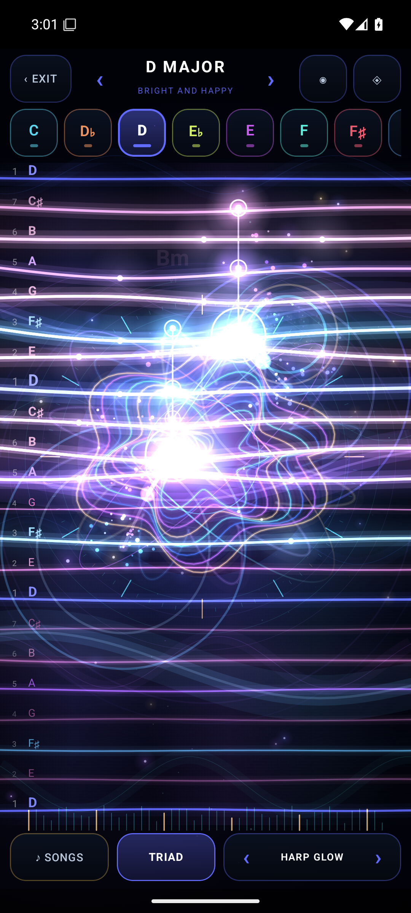
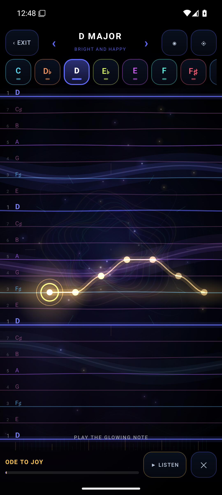
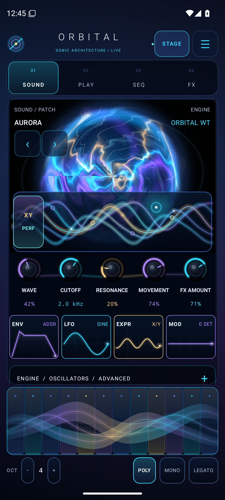
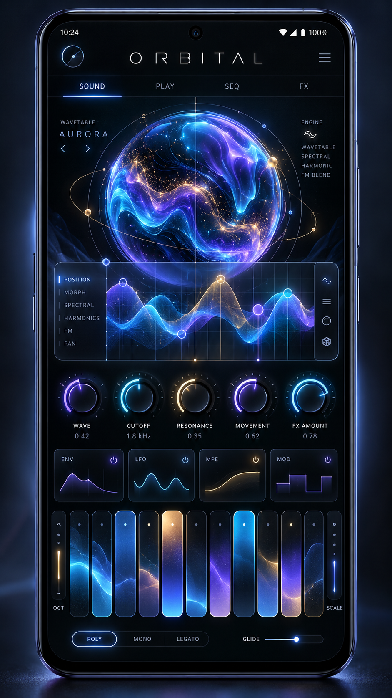

# ORBITAL AURORA — a touch-first Android synthesizer

> **Status:** release candidate **0.3.0** — see [verification](#verification-and-release-gates) for exactly what has and has not been tested. It is a **debug-signed developer APK**, verified on a GitHub-hosted Android 15 (API 35) emulator. It has **not** been measured on physical phones (latency, thermals, speaker output), is **not** Play-signed, and no Play Store release exists yet.

ORBITAL is a native Kotlin/Jetpack Compose instrument for Android 8.0+ (API 26+): a layered polyphonic synthesizer with five sound architectures plus two physical-model sources, built around an expressive touch surface that **teaches you to play**.

## AURORA — play real music with your fingers

Open **STAGE** and the screen becomes a glowing instrument:

- **Choose a key on top.** Twelve colour-coded keys (colours follow the circle of fifths) and a mode stepper across eleven scales — major, minor, Dorian, Mixolydian, Lydian, Phrygian, both pentatonics, blues, harmonic minor and Hirajoshi — each with a one-line mood (“dreamy and floating”, “no wrong notes, ever”).
- **Every lane is a note of that key.** **Bass is at the bottom, treble at the top.** Because only scale tones exist, every touch is in key; slide a finger up and the melody climbs, slide sideways to brighten the tone and play harder.
- **It is alive.** Each lane is a luminous string that leans toward your finger, rings like a plucked string when struck, and sends pulses of light along itself, with ripples, comet trails, sparks and fireflies that swarm toward your touch, and brightness that follows the real audio.
- **One-finger harmony.** SOLO, OCTAVE, POWER, TRIAD or JAZZ 7th: tap a lane and get the right diatonic chord, with its name and Roman numeral (“Dm · ii”).
- **Learn songs by following the light.** Thirteen traditional and public-domain tunes — Twinkle Twinkle, Ode to Joy, Frère Jacques, Canon in D, Oh! Susanna, Jingle Bells and more — are stored as scale steps, so each one plays correctly in *any* key and you can hear it in other modes. The next note glows gold and a ribbon shows the shape of the melody ahead; the lesson **waits for you**, wrong notes still sound but never stop the music, and you earn up to three stars. Press ▶ LISTEN and a ghost finger plays the song for you.
- **Change voice without leaving the stage.** The stage voices — harp, nylon guitar, marimba, music box, electric keys, lead and bass — come right after the default patch.
- **FOCUS** hides everything: pure black until you touch it, then light gathers around your fingers.

Thoroughly touch-first: 48 dp targets, haptics (opt-in), reduce-motion support and an accessible, balanced note lifecycle (every note-on has a note-off, even on gesture cancel, Back, or app switch).

## What it looks like (real emulator screenshots)

These are genuine Android API 35 emulator framebuffers of the debug APK, not mock-ups; the exact source commit, CI run and SHA-256 of every image are in [docs/screenshots/PROVENANCE.md](docs/screenshots/PROVENANCE.md).

| AURORA stage: a held D-major triad on the HARP GLOW voice | AURORA stage: "follow the light" lesson (Ode to Joy) | Main screen (SOUND page) |
| --- | --- | --- |
|  |  |  |

Known visual defects on the main screen, visible above and **not fixed in this release**: the XY PERF chip overlaps the left edge of the waveform editor, and the "ENGINE / OSCILLATORS / ADVANCED" row is partly clipped by the keybed. Only the AURORA stage was redesigned.

## What is implemented

| Area | Current implementation | Boundaries |
| --- | --- | --- |
| Synthesis | **Five selectable engines** plus **two physical-model sources** (plucked STRING, struck GLASS/bell); up to **16 voices**, eight editable oscillator layers, wavetable morphing/unison and analog-inspired/digital synthesis; a transparent **master limiter** | Model-inspired designs, **not calibrated 1:1 hardware emulation** and not sampled instruments; full-capacity device CPU headroom unknown |
| Modulation | Eight programmable LFOs, up to 64 routes, ADSR, performance morph/X/Y, pitch, filter and pan destinations | Finite capacities; not an unlimited modular graph |
| Effects | Six ordered stereo FX slots; saturation, tremolo, chorus, delay, stereo FDN reverb, phaser and bitcrusher; wet/bypass and parameter controls | Quality and long-session performance need listening/hardware evaluation |
| Touch | The **AURORA diatonic stage** (key picker, bass-to-treble lanes, one-finger harmony, song lessons); SOUND, PLAY, SEQ, FX and library controls; multitouch keyboard; on-screen oscillator and modulation editors; keyboardless **FOCUS** black canvas with live audio-reactive visuals | Screen-pressure behavior depends on device input; not a force sensor guarantee |
| Musical tools | Source-aware arpeggiator, 1–64-step sequencer, scales, swing, patterns, touch and Android MIDI input | Physical MIDI keyboards, timing under load and per-note MPE are not fully qualified |
| Presets / storage | **36 factory sound patches**, 12 factory patterns, 13 learnable songs, versioned patch and sequence persistence | Backup/migration and corruption handling still need broad real-device validation |

### Sound sources and architectures

The **SOURCE** control chooses what makes the sound: the engine's own **oscillator**, a **plucked STRING** (extended Karplus-Strong waveguide, pitch checked within 6 cents across C2–C6) or a **struck GLASS/bell** (six inharmonic modes morphing marimba → glass → bell). The chosen engine below still shapes it as the filter and character stage, so a plucked string can run through the ladder filter. Old patches load unchanged.

### Five sound architectures

| Mode | DSP design | Fidelity boundary |
| --- | --- | --- |
| **ORBITAL WT** | Original mip-aware wavetable families, morph and unison | Native digital instrument |
| **LADDER** | Nonlinear four-pole ladder filter with drive/feedback | Analog-inspired; not a circuit-calibrated Model D |
| **SEM** | 12dB multimode state-variable filter | SEM-inspired; not a measured component clone |
| **SIX-OP FM** | Six operators, routing algorithms and feedback | FM synthesis principles; not a bit-identical DX7 |
| **PHASE DISTORTION** | Selectable phase-distortion shapes and tone | CZ-style synthesis principles; not ROM/chip-identical |

## Original generated visual concept — aesthetic reference



**This image is generated concept art, not a capture from ORBITAL.** The main SOUND / PLAY / SEQ / FX screens of the real app are simpler than this reference and still fall short of it in density, lighting and polish; only the AURORA stage was redesigned in this release. Judge current fidelity from the real emulator screenshots listed in [docs/screenshots/PROVENANCE.md](docs/screenshots/PROVENANCE.md), which record the exact commit and CI run each one came from (they can lag the latest source until the publisher has run on `main`).

## Verification and release gates

The merged source ([`4f2ae58`](https://github.com/boop-bip80/Android-synth/commit/4f2ae581492a193b9e9587e286194b0cdac37f6e) on `main`) passed **all nine required jobs** on a GitHub-hosted API 35 emulator in [run 41942904837](https://github.com/boop-bip80/Android-synth/actions/runs/41942904837), and its pull-request head passed the same nine in [run 41940308388](https://github.com/boop-bip80/Android-synth/actions/runs/41940308388), without waiving or weakening any assertion. The matching developer APK is the [debug prerelease `orbital-debug-4f2ae581492a`](https://github.com/boop-bip80/Android-synth/releases/tag/orbital-debug-4f2ae581492a) (debug-signed, not a Play release). On earlier runs of near-identical code, COMPACT350 failed once and passed on an unchanged re-run, RESTART failed twice before passing on the next commit, and GENERAL-0 failed once when the emulator lost display ownership. These are emulator-foreground checks and their root cause is not established beyond that, so treat the emulator lanes as occasionally timing-sensitive. The nine jobs:

1. Kotlin unit tests, Android lint, application APK and instrumentation APK assembly.
2. Android **GENERAL-0** connected-test shard.
3. Android **GENERAL-1** connected-test shard.
4. **COMPACT** interface and screenshot checks.
5. **COMPACT350** short-height screen, pinned piano and touch geometry.
6. **STAGE** real touch, held-note AudioTrack PCM and visual response.
7. **VISUALS** real normal / stage / exit and oscillator/landscape framebuffer captures.
8. **RESTART** process/lifecycle restoration checks.
9. Exact two-shard union verification: every discovered AndroidX test method runs in exactly one of GENERAL-0 or GENERAL-1.

See [quality gates](docs/QUALITY_GATES.md), [screenshot provenance](docs/screenshots/PROVENANCE.md), and [build/CI guide](docs/BUILD.md). Emulator testing establishes specified behavior on an API 35 virtual device; it does **not** establish real speaker output, reliable professional audio latency, sustained thermal headroom, Bluetooth/USB routing, physical MIDI compatibility or visual parity. These require measured physical-device evidence.

## Build locally

Use JDK 17, Android SDK 35 and Gradle 8.11.1 (AGP 8.9.2; Kotlin/Compose 2.1.20):

```sh
gradle :core:test :app:testDebugUnitTest :app:lintDebug :app:assembleDebug :app:assembleDebugAndroidTest
```

Your debug APK is `app/build/outputs/apk/debug/app-debug.apk`. GitHub Actions performs the emulator builds; a local emulator is optional.

## Project structure

- [DSP/music engine](core/src/main/kotlin/com/orbital/synth/core)
- [Android application](app/src/main/java/com/orbital/synth)
- [Architecture](docs/ARCHITECTURE.md)
- [Verification requirements](docs/QUALITY_GATES.md)
- [Build instructions](docs/BUILD.md)
- [Screenshot provenance](docs/screenshots/PROVENANCE.md)

## Still required before a production claim

- Confirm output latency, CPU load, underruns, cold start, thermal/battery stability and routing on actual Android phones over long sessions.
- Validate physical MIDI hot-plug/velocity/CC/bend, high-stress multitouch and accessibility/TalkBack.
- Do measured aliasing, tuning and listening analysis for the analog-inspired and digital engines; do not label them official circuit or chip reproductions.
- Complete UX polish against the generated reference, accessibility review, licensing, signing and reproducible release packaging.

## License

No license has been selected. Do **not** assume the code or visual artwork is open-source-licensed merely because the repository is visible.
